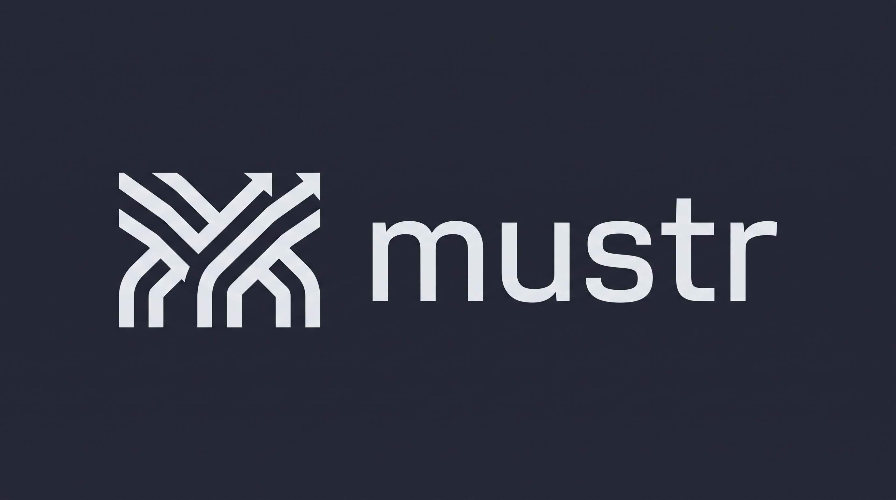

<p align="center"></p>

A terminal-native coordination hub for Pi agents in herdr. Each herdr space gets a dashboard tab; agents join with editable roles and exchange addressed messages. The hub handles task ownership and opt-in scheduling—not model reasoning.

## Install

Requires Rust 1.89+, Node 22.19+, Pi 1.2+, and herdr's socket API. macOS and Linux; `gh` is needed only for PR watching.

```sh
cargo install --path . --locked
mustr install pi
```

Restart Pi or `/reload`.

## Use

Run `mustr` in one herdr tab; its dashboard opens on that tab's current space. Open separate Pi sessions in other tabs of the same space, then select **one role in each session**:

| Pi session | Command |
|---|---|
| Architect's tab | `/role architect` |
| Implementor's tab | `/role implementor` |
| Optional reviewer's tab | `/role reviewer` |

Roles can be selected before the hub starts. Agents keep their own normal Pi conversations. Closing mustr disconnects coordination; it does **not** kill agents or external jobs.

| Dashboard key | Action |
|---|---|
| `Tab`, `←` / `→` | Switch herdr space |
| `t` | Toggle TODO/task continuation |
| `c` | Toggle periodic check-ins |
| `p` | Toggle PR watching |
| `f` | Switch Messages / Tasks tab |
| `r` | Start fresh in this space / inspect reset status (confirmation required) |
| `↑` / `↓`, `k` / `j` | Scroll messages or browse tasks in the active tab |
| `?`, `q` | Help, quit |

Messages and Tasks share a pane with independent scroll positions. The pane border shows total tasks and accepted completions for the selected space; awaiting-review and cancelled tasks are not counted as completed.

Modes start **off**. From the intended Pi recipient, attach a checklist with `/mustr-todo path/to/TODO.md` or a PR with `/mustr-pr https://github.com/OWNER/REPO/pull/123`, then enable its mode. `/mustr pause`, `/mustr resume`, and `/mustr leave` control participation. Escape pauses automated delivery.

## Configure

`~/.config/mustr/config.toml` contains scheduling/UI settings. Editable prompts live in `~/.config/mustr/roles/*.md`; add your own or compose reusable roles using TOML front matter. `$XDG_CONFIG_HOME` and `--config-dir` are supported. Existing role files are never overwritten.

`mustr -v` enables debug logs; `-vv` enables trace logs in `~/.local/state/mustr/mustr.log`. The UI uses your terminal's foreground/background and ANSI palette; `NO_COLOR=1` disables color accents.

[Configuration and roles](docs/configuration.md) · [Start fresh](docs/start-fresh.md) · [Behavior and protocol](docs/architecture.md) · [Development](docs/development.md)

Licensed under [GPLv3](LICENSE) (`GPL-3.0-only`).
